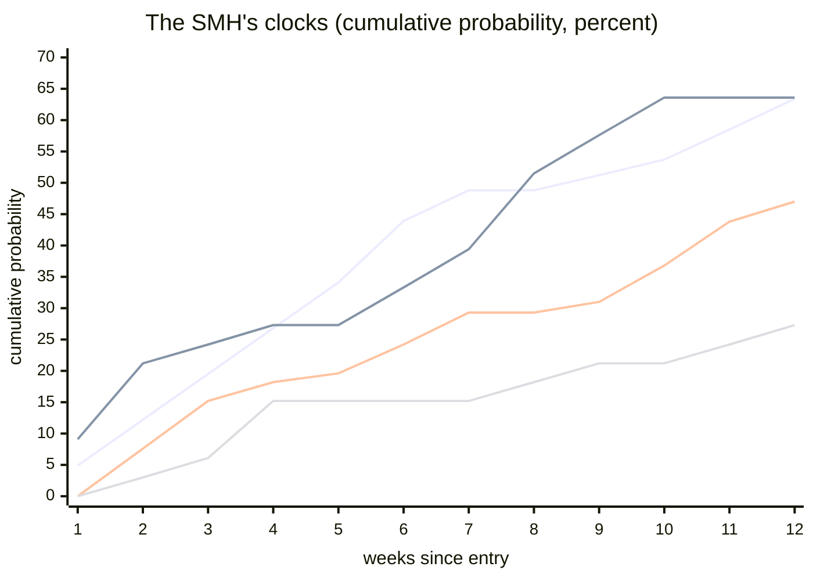

# The Salient Market Hypothesis (SMH) — charter v3

Named by Andrea, 12 November 2026: the framework was drafted as the
State-Clock Framework and adopted its standing name the same day. Same
object, same falsification rules; every future reference says SMH.

AMENDMENT RECORD (per section 9, rule 3 — supersession happens by
recorded, dated amendment only): this is charter v3, 12 November 2026.
It supersedes charter v2 (same day, earlier session; preserved in the
git history). v3 adds: the mid clock and the salience gradient (the
fifth measured tick — mid 0.470 ~ climatology 0.441, stress suppresses
0.273; salience is EDGE-LOCAL), the event's own anatomy (the sixth
measured tick — in-spell/escape-week/post-escape split, the law-4
volume signature at the weekly grain, the 1.41x overshoot, the up/down
volume asymmetry), the four-line clock chart, the timeliness refinement
in section 14.3 (act dissolved at spell end captures 0.439 vs the
entry-anchored 0.634), section 14.8 (the salience gradient as the
completed machine), and the updated design-complete declaration
(20 checks; the priced-expectations benchmark; the event-structure
unseen-ness test now needs options term-structure data).

A theoretical framework for identifying, in advance, the significant
events in a market. Written as a direct replacement for Elliott Wave:
it keeps what Elliott got right, discards what Elliott got wrong, and
adds the dimension Elliott never had, time. Built from the 20-book
canon and the paper waves (Balan, Williams, Copsey, Hasbrouck, Kyle,
Bouchaud, Tsay, Hamilton, Clark, Sornette, Lo, and the rest), and from
the AVFI programme's own measured results.

## 1. The diagnosis of Elliott Wave

What Elliott Wave got right, and why it survived a century:

1. Markets alternate between impulse and correction. TRUE, and now
   measured: returns show horizon-structured autocorrelation,
   persistence at weeks-to-months and reversal at multi-year horizons.
   The alternation is real; the 5-3 cage around it is not.
2. The same structure appears at multiple scales. TRUE in the
   volatility sense: volatility is multifractal, correlations
   aggregate across heterogeneous trader horizons (Muller's HARCH,
   Bouchaud's stylized facts). Self-similarity lives in the variance
   process, not in a fixed price geometry.
3. Crowd psychology evolves in phases that leave footprints. TRUE:
   herding, order-flow correlation, and the volume-price
   effort-vs-result relation are documented stylized facts. VSA read
   them verbally; order-flow research measures them.

What it got wrong:

1. The fixed 5-3 form. Copsey's own finding: every impulse can be
   counted as a three. A form that cannot be counted wrong cannot be
   counted right.
2. Fibonacci price ratios as targets. No statistical evidence anywhere
   in the canon. Geometry licenses them as measurement tools only; a
   ratio is a description, not a prediction.
3. Unfalsifiability. Any count can be recounted, any correction
   extended. A theory that cannot fail predicts nothing.

What it never had, and you correctly identified as the gap: time.
Elliott says where, never when. Every "when" in wave practice is
retro-fitted. The framework below makes time a first-class dimension.

### The supersession case, stated as a capability matrix

| capability | Elliott Wave | the Salient Market Hypothesis |
|---|---|---|
| what it predicts | a fixed 5-3 price geometry | conditional hazards: a significant week within 4/12 weeks of a compression entry (0.268 / 0.634), de-stress within 4/12 weeks of a stress entry (0.273 / 0.636) |
| what it says about time | nothing; every "when" is retro-fitted | the clock IS the theory: spell dwell, transition rates, the quarter rule |
| can it fail in public | no: any count can be recounted | yes: every forecast row is logged in advance and Brier/log-scored as windows complete |
| what it refuses | nothing: dates, targets, ratios all claimed | dates, targets, wave counts, Fibonacci ratios, direction at a chosen time |
| the alternation claim | asserted as a fixed form | measured as the transition structure (13/13, 11/13) with unscheduled timing |
| practitioner instruction | count the waves, apply the ratios | read the region, read the spell age, wait for a clock entry, log the row, take the score |
| data requirements | a chart and belief | weekly OHLCV and the discipline of advance logging |
| scoreboard | none possible, in a century of practice | empty by design today; filling from the first forward row onward |

Honesty note, kept beside the table: the supersession is structural,
not yet proven. Every capability on the right is a claim that CAN fail,
which is precisely what Elliott Wave never had. The forward log is the
test; it is empty until the market's next clock entry, and the matrix
earns its last row only by accumulating score.

## 2. The ontology: what a market is

From Hasbrouck and the microstructure canon. A market is a matching
engine plus participants managing inventory plus informed flow. There
are two prices: a latent efficient price, moved by information and
inventory pressure, and the transaction price, which oscillates around
it. The transaction path equals the efficient path (near a random walk
with drift) plus mean-reverting noise.

From Clark, Mandelbrot, and the VPIN wave: the efficient price does not
evolve in calendar time. It evolves in trading time, clocked by volume
and volatility. All "when" questions must be posed in the right clock.
A week of calendar time can be an hour of trading time, or a month of
it.

From Hamilton and Diebold-Inoue: the process switches regimes slowly,
and what looks like long memory can be a sequence of breaks. Structure
exists, but it is statistical, not geometric.

## 3. The six unconditional laws

These are the inevitables, the axioms of the framework. Each is
documented, each carries its evidence anchor, and each is stated with
its use as a rule. This is the honest list of things that happen
unconditionally; note carefully what is not on it.

1. Volatility persists, then mean-reverts. High vol weeks follow high
   vol weeks; compressed vol expands. (Tsay's GARCH persistence; the
   clock study's frozen tercile tables.) USE: this is the clock itself.
2. Tails are heavy. Return distributions are non-Gaussian at every
   horizon. (Bouchaud's stylized facts; Student-t conditional tails.)
   USE: all thresholds, stops, and event definitions live in sigma
   units, never in fixed points.
3. Autocorrelation has horizon structure. Momentum at medium horizons,
   reversal at long ones, near-zero at short ones. (Jegadeesh-Titman;
   De Bondt-Thaler; time-series momentum in all 58 contracts of the
   Moskowitz-Ooi-Pedersen study; the programme's own rule set T, its
   only replicated effect.) USE: the directional prior, valid only
   inside trend states and only at the right horizons.
4. Impact is concave in volume. Big moves require big flow, and flow
   leaves footprints. (Kyle's lambda; the square-root law;
   Cont-Kukanov-Stoikov's OFI.) USE: a significant event must be
   confirmed by volume, the formalized version of VSA's
   effort-vs-result. A move without volume is a suspect move.
5. Events self-excite. Price changes cluster in time, mostly
   endogenous. (Hawkes processes; Filimonov-Sornette's reflexivity
   measurements.) USE: hazard is state-dependent, so timing forecasts
   are conditional distributions, never constants.
6. Every exploitable regularity decays. The market adapts to whoever
   uses it. (Lo's adaptive markets; the programme's own holdout
   lesson.) USE: every rule in this framework carries a forward
   calibration score and a decay watch. Nothing is forever, by law.

Not on the list, and provably not on the list: the direction of the
next impulse at a chosen time. That absence is the framework's central
theorem, next.

## 4. The central theorem: the certainty-timing-direction triangle

In a public market, suppose a rule identifies, before it happens, an
event that is all three: certain, timed, and directional. Anyone who
sees the rule trades it; the price moves to the forecast; the event no
longer happens as forecast. Therefore such a rule cannot exist
publicly. It exists only privately: as informed flow (knowing
something others do not) or as speed (seeing it first). Kyle built the
formal version of this; the microstructure canon is its case law.

So the claims must be distributed honestly:

- CERTAINTY lives at the level of the distribution (the six laws).
- PROBABILITY lives at the level of the event (conditional rates by
  state).
- HAZARD lives at the level of timing (the clock).

Elliott Wave implicitly claimed all three and therefore made zero
testable predictions. The Salient Market Hypothesis claims them
separated, and every separated claim is scoreable. That is the
replacement in one sentence: Elliott had anatomy without a clock and
without the possibility of being wrong; this framework gives the
market a clock and a scoreboard.

The observer corollary (added 12 Nov 2026): the only forecast that
cannot be priced away is the private one. Three forms exist:
information others do not have (informed flow), speed others do not
have (infrastructure), and a calibration record others have not
measured (a forward-scored log). SMH can build only the third, and it
is the right one for this programme: it cannot move the market because
it is not public, it cannot be flattered because it is scored in
advance, and it compounds, because every scored forecast sharpens the
tables. The inevitable future in public, certain, timed, directional
form is visible to no one; the private observer's honest maximum is a
distribution, a clock, and a scoreboard. That is not a consolation
prize. It is the whole difference between a belief and an instrument.

## 5. The state layer: what replaces wave counting

States are defined by measured quantities, never by counting. Four
states, on the instrument you trade, at the decision horizon:

- COMPRESSION: low volatility tercile. The event-prone state: the
  clock study measured a 47 percent rate of a significant 4-week move
  from this state, versus 14 percent from high vol. This is where the
  anticipated event becomes likely, and it is the state Elliott's
  "base" and Copsey's accumulation describe verbally.
- TREND: persistent directional drift. Law 3's prior is valid here and
  only here. Occupancy and persistence are measured, not asserted (the
  programme's stage 2 event studies did exactly this).
- EXPANSION: the event window, active while the significant move is
  in progress. Law 4 operates: confirmation requires the volume
  footprint.
- STRESS: the post-event tail regime. Law 2 operates: sizing cuts,
  expectations widen.

What wave psychology called phases (optimism, disbelief, euphoria,
denial) are not prophecies here; they are names for measured occupancy
durations and transition rates. That is the entire difference between
description and divination.

## 6. The clock layer: time as a first-class dimension

The primary clock is volatility. At each decision close: sigma_w
(trailing 8-week weekly vol), its tercile, and the frozen conditional
tables give the hazard of a significant event within the next 4 weeks.
The secondary clock is volume time (needs finer data than weekly
OHLCV; the broker/CME export standing item feeds exactly this). The
tertiary clock is self-excitation (needs intraday data; out of scope
for now, documented as such).

Timing in this framework means: a conditional hazard function, updated
at every decision close, scored against outcomes. Not a date. A date
is what an open system cannot give, because a date would collide with
the central theorem the moment anyone believed it. The hazard IS the
"when", and the clock study is its measurement instrument: probability
logged in advance, Brier-scored, reliability-diagrammed. The 47 versus
14 percent tercile spread is the first measured tick of this clock.

Hazard layer v0, corrected (12 Nov 2026, the second measured tick):
conditioning on compression ENTRIES (crosses into the low tercile,
n = 41 pre-2021, design bookkeeping only), the discrete Kaplan-Meier
hazard of the first significant 1-week event RISES with weeks since
entry, through about 0.15 at week 6, cumulative event probability 0.63
by week 12, median lag 5 weeks, and the compression state roughly
doubles the weekly event rate (0.0969 vs 0.0448 unconditional). The
direction split of first events shows the shape the hypothesis hunts,
honestly flagged: compression entered after a down 12-week move
resolved its first event up 6 of 7 times (n = 7, seductive cell,
untrusted until forward-scored). The mathematics is survival analysis,
the same spine as clinical time-to-event research: the medicine bridge
is now measured, not just proposed. Cox layer v0.1 (same day):
entry-condition covariates (momentum sign, AVFI state, compression
depth) all point the predicted way but beat duration alone by only 1.4
percent out of fold; the honest verdict is that the hazard content so
far IS the clock, not the entry conditions. Correction note: the first
frozen KM table carried an off-by-one in its risk set (caught by an
independent person-week reconstruction, now a standing consistency
check); corrected numbers here and in the bundle documents. Full
frozen tables, caveats, and the forward protocol: the SMH hazard layer
v0 and Cox layer v0.1 documents in the programme bundle.

Stress clock v0, the mirror edge (12 Nov 2026, the third measured
tick): the other side of the volatility cycle is now timed in the same
survival form. Stress entries (crosses above the frozen high cut,
n = 33 pre-2021) de-stress with cumulative probability 0.636 by week
12, median lag 6, and a one-in-three tail that stays in stress a full
quarter. The quarter rule: BOTH edges of the cycle resolve with nearly
identical two-thirds probability within a quarter (0.634 vs 0.636),
medians 5 and 6, as one mean-reverting variance machine predicts. Two
quiet findings: stress decays by calm, not crash (20 of 21 de-stressed
episodes saw NO significant week first; the de-stress week itself is
quiet in 64 percent of cases, with an honest roll-off caveat), and
NOTHING conditions the stress clock (no momentum split, no state cell,
no seductive cell at all, unlike the compression side). The instrument
now drafts forecast rows for both clock edges, and its selftest
reproduces every frozen table from the raw data. Full tables and
caveats: the SMH stress clock v0 document in the programme bundle.

The dwell and transition machine (12 Nov 2026, the fourth measured
tick, which completes the clock): the clock is a genuine three-state
machine with measured dwell and jump structure. Stress dwells twice
as long as compression (mean 13.3 vs 7.0 weeks, max 86 vs 29) and
occupies the most calendar time; mid is the fast exchange (median 3
weeks) splitting exits 0.56 back to compression and 0.44 up to stress;
compression exits to mid 93 percent of the time, jumping directly to
stress in only 3 of 41 exits (the no-warning event, rare and real).
The state layer is measured in the same units: the alternation Elliott
named is the TRANSITION structure (momentum_up hands to reversal_down
in 13 of 13 spells; reversal_down hands back to momentum_up in 11 of
13), while the TIMING carries no schedule (reversal_down dwells a
median 11, mean 29.7 weeks), reversal_up occupied just 26 weeks in
twenty years (the climax quota is an occupancy fact, not a sampling
accident), and state and clock are nearly orthogonal in joint
occupancy: the state cycles while the clock ticks, neither forecasting
the other. Full tables: the SMH transitions v0 document in the
programme bundle.

The clocks, drawn (pre-2021 design bookkeeping; the quarter rule is the
crossing of the two upper curves at the right edge; the salience
gradient is the vertical spread between the three event clocks at the
12-week edge):

Mid clock v0 and the salience gradient (12 Nov 2026, the fifth measured
tick, which completes the entry clocks): all three regions now carry
the same entry-anchored first-event clock. Mid entries (crosses into
mid, n = 66 pre-2021) produce a first significant week with cumulative
probability 0.470 by week 12, Greenwood 95% [0.349, 0.590] -
statistically indistinguishable from climatology (0.441 [0.411,
0.471]), unlike the compression edge whose band is disjoint from it.
Stress entries suppress the event clock (0.273 [0.121, 0.425]). The
gradient is monotone in the point estimates: 0.634 > 0.470 > 0.441 >
0.273. THE SALIENCE IS EDGE-LOCAL: the entry information lives only at
the compression cross; mid is the machine's fast exchange and carries
none of it; the stress edge's own clock is de-stress. A suggestive
quiet handoff is flagged beside it: zero first-week events after mid
and stress entries (0 of 99, climatology expects about 4.4; the
mechanical threshold caveat is frozen beside the flag). Nothing
conditions the mid clock (entered from compression 0.447 vs from
stress 0.500, bands overlapping): only the compression edge carries
entry-conditioned structure in this sample. Mid rows stay out of the
forward log by design: the null is the statement. Full tables: the SMH
mid clock v0 document in the programme bundle.

The instrument reads the machine's live position against these tables:
the status command reports the current clock region, the current
spell's age in weeks against the measured dwell distribution (median,
mean, max), and the current state spell's age - the operational
replacement for counting waves. What it does NOT do is convert spell
age into a forecast: age is descriptive context; rows are logged only
at clock entries, per the protocol.

## 7. The event: what you anticipate, identified before it happens

Definition, pre-registered: a significant event is a move of at least
2.5 sigma_w within 4 completed weeks (the clock study's frozen
threshold). Identification before it happens = the pre-event signature:

1. The clock: compression-state vol tercile (hazard elevated, 47
   percent).
2. The state layer: which states are legal exits of compression, and
   what the horizon structure says about direction inside each.
3. The flow layer: at finer horizons, the volume/OFI footprint that law
   4 requires of any genuine impulse (needs finer data; documented).

The signature raises probability. It never reaches 1, and the framework
says so in its own axioms (theorem, section 4). The Sornette
log-periodic program is the canon's model of a precursor signature:
pre-registered, ex-ante, with a public record of hits and misses. This
framework adopts the pattern and refuses the certainty.

The event's own anatomy, measured (12 Nov 2026, the sixth measured
tick, pre-2021 design bookkeeping): the anticipated event has now been
dissected, and the dissection resolved a real tension in the theorem.
The forecast clock is entry-anchored (the logged row resolves at 12
weeks regardless of the region, probability 0.634), but the act that
dissolves at spell end is spell-anchored, and the two windows are not
the same: of the 26 first events after compression entries, 7 arrive
strictly in-spell, 11 ARE the escape week itself, and 8 arrive after
the region already escaped. The spell most often dies OF its event (11
of 26, the measured mechanism form of "expansion out of compression");
an act dissolved at spell end captures 0.439, not 0.634, the 0.195 gap
being the armed-clock mass that keeps running after the region read
changes. The event also carries its law-4 signature at the weekly
grain: significant weeks come on median volume 1.138 times their
trailing baseline (all weeks 1.004), 70 percent above baseline versus
51 percent, and zero thin-flagged event weeks - effort confirms
result, measured. Size: the median first event overshoots its own
2.5-sigma bar by 1.41x, so the anticipated change is concretely a
~3.5-sigma week. One asymmetry flagged beside it: up events arrive on
below-baseline volume (median 0.938), down events on nearly double
(1.733) - the effort-vs-result relation's weekly shape, suggestive at
n = 17/9, untrusted until forward-scored. Full tables: the SMH event
anatomy v0 document in the programme bundle.

## 8. What the framework predicts, and what it refuses

Predicts (all scoreable, all forward):

- Conditional event rates by state and tercile (clock study).
- Hazard of expansion from compression, updated weekly.
- State occupancy frequencies and persistence times.
- Direction asymmetry (drift) conditional on trend states (law 3).
- Volume confirmation of genuine impulses (law 4).

Refuses (permanently, by the central theorem):

- Dates. Price targets. Wave counts. Fibonacci projections. Certainty
  about direction at a chosen time.

Anything the framework refuses to output is something no public theory
can output honestly; the ones that claim to are the ones that have
never been scored.

## 9. The falsification protocol

The framework's most important layer, and the one that makes it a
replacement rather than a repeat of Elliott:

1. Every quantitative claim is scored forward: probability forecasts
   logged before outcomes (Brier, log score, reliability diagrams).
2. A claim that cannot be scored is not part of the framework.
3. Supersession happens by recorded, dated amendment only; nothing is
   silently rewritten.
4. The human forecaster (your calls, the judgment log concept) is
   inside the protocol as a component to be calibrated, not an oracle
   outside it.
5. Decay is watched by law 6: every rule's calibration record is its
   life expectancy.

Elliott Wave fails every one of these five. That is the succession.

## 10. Relation to what already exists

This framework is not new machinery; it is the theoretical layer the
AVFI programme discovered empirically, piece by piece:

- The AVFI state machine: retained as the regime descriptor of the
  state layer. Its measured verdict stands: it describes regimes; it
  does not predict direction, and its timing content is weak (the
  clock study: 21-29 percent across the three adequately populated
  states, versus climatology 28.5).
- Rule set T: law 3 in production.
- V and V4h sizing: law 1 in production (vol targeting).
- The clock study: the clock layer's measurement instrument, with its
  frozen tables.
- The validation spine (RC, SPA, single-open holdout, FTEP): the
  falsification layer.
- Elliott Wave itself: retained as lineage and context (Balan's
  discipline, the alternation insight), the theory this framework
  replaces.

## 11. Open problems: where the hunger goes next

Each is a genuine research problem, none is a lottery ticket, and the
first is shared with medicine:

1. Hazard estimation. Regime switching crossed with survival analysis:
   Hamilton's states meet Kaplan-Meier and Cox. Time-to-event
   methodology, identical in spine to clinical research. This is the
   mathematics the clock layer needs to grow from tercile tables to a
   proper hazard model. UPDATE 12 Nov 2026: Kaplan-Meier v0 exists
   (hazard layer v0, corrected after an off-by-one caught by the
   person-week reconstruction) and Cox v0.1 exists (covariate layer):
   the covariates point the predicted way but do not yet beat duration
   alone out of fold. Remaining: direction modeling of first events
   (deferred, n = 26), and covariate review after forward episodes
   accumulate.
2. The volume clock. Clark's subordination measured on real NQ data.
   Blocked only by data quality (the broker/CME export standing item).
3. Precursor signatures beyond volatility. Can any weekly-observable
   footprint raise the event hazard above the tercile table? This is
   where AVFI returns honestly: not as an inevitability, as a testable
   signature with a calibration score. The reversal_up 0.385 cell
   (n=26) is the standing example of what a seductive cell looks like
   before it has earned trust.
4. Self-excitation measurement. Hawkes estimation needs intraday
   data; documented as out of scope until the data exists.
5. The Bayesian forecaster. Human prior times measured calibration:
   the formal version of integrating your judgment (the judgment log)
   into the hazard model once it has a score.

## 12. The doctrine: how an SMH observer lives in the market

The theory earns its name only as a practice. This is the ideology,
stated as rules of life rather than rules of trade:

1. THINK IN HAZARDS, NOT DATES. An SMH observer never asks when. The
   observer asks: given this state, what is the hazard this week, and
   how does it accumulate. A doctor does not tell a patient the date.
   A doctor gives a survival curve and manages the case against it. The
   market gets the same honesty: compression resolves into a first
   significant week with about two thirds probability within a
   quarter, median around 5 weeks, and one entry in three stays quiet.
   That is the entire when, and it is enough to act on, because it is
   scoreable.
2. FORECAST IN ADVANCE OR NOT AT ALL. A view that was not logged
   before the outcome does not exist. The instrument refuses noise by
   design: rows exist only at clock entries, only on the decision
   cadence, never twice for the same week, never revised after the
   fact.
3. TREAT CERTAINTY AS A DISTRIBUTION, DIRECTION AS A PROBABILITY,
   TIMING AS A HAZARD. Never trade all three as one claim; the
   triangle says such a rule cannot survive publicity. The private
   edge is the calibration record: information and speed belong to
   other people's infrastructure; the scored, compounding record
   belongs to whoever keeps it.
4. RESPECT THE QUIET FINDINGS. Stress decays by erosion, not
   catharsis: after a vol spike the crowd braces for the flush, and
   the measured record shows twenty of twenty-one de-stresses arriving
   without any significant week at all. The market's drama is in its
   events; its recovery is in its boredom. Trade the boredom where the
   crowd prices the drama.
5. SEDUCTIVE CELLS CARRY THEIR FLAGS FOREVER. Any conditional cell
   small enough to flatter (the 6-of-7 compression-after-decline cell
   above) stays flagged until forward scoring earns it silence. Nothing
   gets promoted by telling a better story.
6. CORRECTIONS ARE PART OF THE RECORD. The frozen tables have already
   caught their own bugs (three in the hazard layer's first days),
   because every table must survive an independent reconstruction
   before it counts, and every failure is logged in place. A doctrine
   that cannot admit error cannot keep score, and scorekeeping is the
   whole doctrine.

## 13. The honest close

The inevitable, unconditional rules exist: the six laws. They were
found, not invented, and they are the closest thing to market truth
anyone has. What they inevitably produce is a distribution, and the
anticipated event appears inside it with a probability you can state in
advance and a clock you can score. The theory that replaces Elliott
Wave is this: state instead of count, clock instead of prophecy,
calibration instead of belief. It is less romantic than waves, and it
has one property no wave theory ever had: it can be wrong in public,
which is the only way anything in markets can ever be right.

## 14. The entry condition set: the theorem, boiled down

Added 12 November 2026 (session 37). The whole framework compressed
into one falsifiable machine (instrument: smh_theorem.py, theorem card
and selftest; tables in the entry-theorem doc). The boiled-down form
answers the founding question of this canvas, what conditions produce
the anticipated change and the timely entry, without ever claiming the
impossible corner of the triangle:

THE TRIGGER (one condition, measurable at the decision close): sig_w
crosses into compression (sig_w <= 0.01739 after being above it). THE
ANTICIPATED EVENT (defined before the fact): a significant week, |r1|
>= 2.5 sigma_w, within 12 weeks.

1. OCCURRENCE: P(event within 12 weeks | trigger) = 0.634, Greenwood
   95% [0.487, 0.782]. The counterfactual (the same clock started from
   any week) is 0.441 [0.411, 0.471]. The bands do not overlap: even
   the conservative lower bound of the entry condition beats the upper
   bound of doing nothing. This is what salience means operationally,
   and the weekly rate ratio is 2.16 [1.38, 3.39].
2. TIMING: the hazard is front-loaded, median lag 5 weeks, cum 0.268
   by week 4. The clock is the when.
3. TIMELINESS: entering at the cross captures 0.634 of the window;
   waiting 4 quiet weeks leaves 0.500; waiting 6 leaves 0.348. Waiting
   forfeits measured hazard mass and races the spell's own mortality
   (median dwell 4 weeks). Timeliness is not a felt skill; it is a
   measured 0.634-versus-0.348. One refinement, measured: an ACT
   dissolved at spell end captures 0.439 (18 of 41), while the
   FORECAST row stays entry-anchored (0.634); 8 of 26 events arrive
   after the region already escaped, and the spell most often dies OF
   its event (11 of 26).
4. DIRECTION: REFUSED in v0. The up-split's 95% lower bound (0.443) is
   below one half, so the anticipated change is a significant MOVE,
   not a signed one. The seductive cells stay flagged until
   forward-scored.
5. ABORTS: the set dissolves when the spell ends without event, when
   12 quiet weeks pass (a scored miss, 36.6% of the mass), or at
   censoring.
6. KILL LINES, pre-declared: the occurrence claim dies in public if,
   at 10, 20, 40, 60 scored forward rows, the event count is at or
   below 3, 8, 19, 31 respectively.
7. THE MIRROR: the stress trigger carries P(de-stress within 12
   weeks) = 0.636 [0.472, 0.801], median 6, no direction claim at all,
   decaying by calm, not crash.
8. THE SALIENCE GRADIENT, the completed machine: all three regions
   measured with the same entry-anchored clock, the 12-week
   first-event cumulative is monotone in the entry region:
   compression 0.634 [0.487, 0.782] > mid 0.470 [0.349, 0.590] ~
   climatology 0.441 [0.411, 0.471] > stress 0.273 [0.121, 0.425].
   Salience is EDGE-LOCAL: only the compression cross separates from
   the do-nothing counterfactual; a mid entry is statistically
   indistinguishable from picking a week at random; the stress edge
   suppresses events, its own clock being de-stress. The hypothesis
   earns its name locally, not globally, and the edge-local finding is
   itself a claim the forward log can score.

The long-run lemma closes the "inevitable" question with the only
honesty markets permit: the measured region chain is irreducible (all
six directed links observed, none absorbing), so the trigger recurs
indefinitely and the anticipated EVENT is actuarially inevitable across
the cycle, exactly as a life table makes death inevitable and no death
dated. Inevitability lives in the recurrence, probability in the
entry, hazard in the timing; the date and the sign stay refused until
forward rows earn them. That is the boiled-down theorem: one trigger,
one event, one clock, bounded claims, public kill lines.

Design-complete (12 Nov 2026): every layer of this framework
reachable with current data now has measured tables: the laws (the
programme's prior results), the clock (both edge clocks, the dwell and
transition machine, the quarter rule), the states (occupancy,
transitions, joint table), the event (both KM clocks, all seductive
cells flagged, the anatomy dissected), the covariates (the Cox v0.1
null verdict), the priced-expectations benchmark (the unseen-ness
layer: level-cheap, mean-priced), and the falsification machinery
(forward protocol, drafting instrument, resolver and scorer, all
selftested and wired into the verification chain, 20 checks). What
remains is exactly two things, and neither is theory: episodes (the
forward rows that only the market's future clock entries can produce)
and data (the volume clock and Hawkes layer need the broker export;
the event-structure unseen-ness test needs options term-structure
data). The framework is finished being built. Now it waits to be
scored.

## 15. The trade-inevitables (added 12 November 2026, dated
amendment per section 9 rule 3)

The rule additions, oriented at trade construction (Layer 5 of
the strategy architecture: entry, invalidation and exposure from
measured distributions). Measured on the programme's pooled
universe (188 series) and its anchored assets, with the honesty
conventions throughout - including the negative results, which
are rules too:

1. THE ARMED CLOCK'S DRAWDOWN PROFILE: at the pooled daily grain
   the waiting drawdown before the first significant week (median
   0.89 sigma-bars, p75 1.40) is NOT a small fraction of the
   event's own size (median 1.28 sigma-bars): RR by construction
   1.44 - FOLKLORE. The armed clock is a TIMING instrument, not a
   low-drawdown structure by itself; the stop must come from the
   exposure layer, not from the clock.
2. THE CRASH-DEPTH GRADIENT: on anchored assets the weekly-crash
   bounce is real at every depth (all buckets positive median
   forward 4 weeks), but the gradient is NOT monotone in depth.
   The measured best-buy zone is the MODERATE weekly crash
   (-5% to -10%: +2.0%/+2.2% median, 60-62% positive, n = 709);
   the nuclear-red (-15% and worse) reads +1.1% at 54% (n = 96).
   The -15% rule as stated is FOLKLORE on these assets; the
   moderate crash is the entry condition the data supports -
   and its n is small enough to stay flagged until forward-scored
   (doctrine rule 5).
3. THE POST-EVENT CALM: at the pooled grain the week after a
   significant week is quieter than baseline only 51.8% of the
   time - no measured calm re-entry window at this grain
   (FOLKLORE). The charter's stress-decay-by-calm finding stands
   on its own instrument; the daily-grain analogue does not
   replicate pooled.

Design-sample caveat, kept beside every number above: these are
design-sample findings on historical data, not independently
established live performance. The forward calibration record
remains the test that matters.

## 16. The exit rules, measured (dated addition, 12 November 2026)

The layer-5 follow-up to the timing battery, on the same episode
entries (the crash-zone cross, one entry per episode, 206 trades
on the anchored set). Instrument: exit_battery.py; every cell
reported, none cherry-picked.

1. THE HOLD LADDER: no shorter hold earns its keep. The 1-week
   hold fails the dual-split gate; 2w and 3w read below the
   4-week baseline median; the 4-week hold stands. The timing
   realization curve (~47% by week 2) does NOT license an early
   time exit - the bounce keeps paying after week 2.
2. THE PROFIT TAKE, PER TRADE: exiting at the first week
   clearing +4% lifts the per-trade median (0.0415 vs 0.0169)
   and passes the gate. Seductive - flagged.
3. THE PROFIT TAKE, AT PORTFOLIO LEVEL: CUTTING WINNERS LOSES.
   On the calendar-date grid, the same entries with the +4% take
   compound to -36.0% total (CAGR -8.6%, maxDD 60.9%) against
   the production hold's +83.6% (CAGR +11.3%, maxDD 46.6%). The
   mechanism is measured: the take RAISES the median but CUTS
   the mean (0.0052 vs 0.0086) because it truncates the right
   tail (winners' mean 0.0797 to 0.062) while losers stay full.
   THE MEDIAN IS NOT THE PORTFOLIO - a new doctrine-grade rule:
   no exit rule is judged by per-trade medians; the calendar-grid
   simulation is the referee.
4. FEWER TRADES: the v4_confirmed filter (a v4 confirmed bottom
   within +/-3 bars of the cross) cuts the book 87% (206 to 27)
   with a gate-passing median - flagged, and its per-asset
   breakdown shows BTC/ETH/GC negative inside the cell.
   compression_at_entry and the falling-knife filter do NOT
   earn their trades (honest nulls; the latter never fires - the
   zone cross is always the first crash week in this sample).
5. THE CONCENTRATED BOOK, AT PORTFOLIO LEVEL (same addition,
   second referee run): the v4_confirmed book does NOT
   compound better - 27 trades give -16.3% total (CAGR -10.1%)
   against the full book's +83.6% (CAGR +11.3%). The slightly
   better per-trade median (0.0182 vs 0.0169) was razor-thin and
   does not survive the starved exposure. The unfiltered zone
   cross stands at portfolio level, and the v4_confirmed cell
   keeps its flag forever (doctrine rule 5).

Design-sample caveat, unchanged: every number above is
design-sample; the forward calibration record remains the test
that matters.
